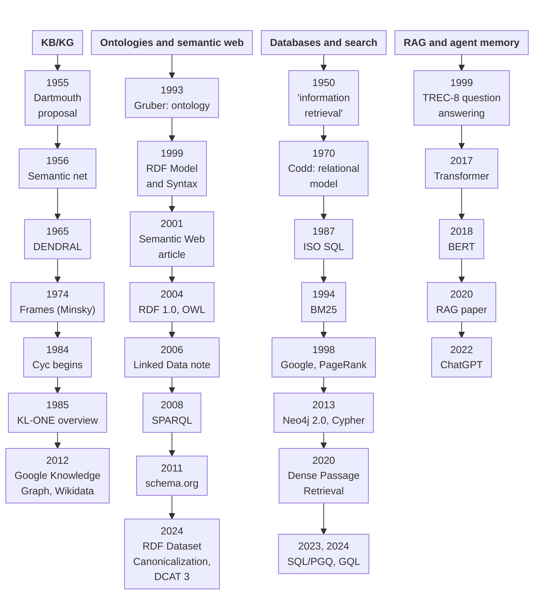

# History: how knowledge bases and knowledge graphs evolved

This chapter answers one question: how did [knowledge bases](../index/knowledge-base.md) and [knowledge graphs](../index/knowledge-graph.md), and the data and search systems around them, get from 1950 to now? It tells the story in eight eras, each with its own page, and in four threads: knowledge bases and graphs (the main thread), [ontologies](../index/ontology.md) and the [semantic web](../index/semantic-web.md), databases and search, and [RAG](../index/retrieval-augmented-generation.md) and [agent memory](../index/agent-memory.md). The eras are this documentation's own: no source gives one scheme for all four threads, so each boundary is a point that two or more sources share, and each era page gives its reason [1]. Chapter 1 holds what is settled (it became a standard, it became common practice, or a successor replaced it); what is still moving, whatever its date, is in chapter 2, [the trends](../trends/README.md).

What has settled since 2023 is little: two ISO graph-query standards ([SQL/PGQ](../index/sql-pgq.md) and [GQL](../index/gql.md)) and two W3C Recommendations of 2024 on RDF data and data catalogues (RDF Dataset Canonicalization, 20240521, and [DCAT](../index/dcat.md) 3, 20240822; the W3C list as a whole was not surveyed) [8]. RAG is not on the list: one survey calls it widely adopted, which is evidence of adoption only [8][9]; it is told in chapter 2, in [graph-based RAG](../trends/graph-based-rag.md) and [agent memory](../trends/agent-memory.md). Everything earlier is told era by era, in the timeline and the "Eras at a glance" table below.

## Timeline

The diagram shows the 31 milestones of the table below in four lanes, one per thread, from left to right: knowledge bases and graphs; ontologies and the semantic web; databases and search; RAG and agent memory. Each box is a milestone, except three that hold two (Google's Knowledge Graph and Wikidata; RDF Dataset Canonicalization and DCAT 3; SQL/PGQ and GQL). Read each lane from top to bottom in time order: the vertical spacing is not to scale, and boxes on the same height in two lanes are not of the same year. Each milestone is told on the era page named in the table; the Source column gives the number in the Sources list at the foot of this page, which is that era page.

The same milestones as a table, for readers whose viewer does not draw the diagram. Dates are as the era page gives them: `YYYY`, `YYYYMM` or `YYYYMMDD`. A date with only a year means the day is unstated there.

| Date | Event | Thread | Era | Source |
|---|---|---|---|---|
| 195003 | Mooers's paper uses "information retrieval"; the term is first used about now | Databases and search | [The advent](advent.md) | [1] |
| 19550831 | Dartmouth proposal for a summer 1956 study of artificial intelligence | KB/KG | [The advent](advent.md) | [1] |
| 1956 | Richens: "semantic net", the earliest use Sowa reports (which Richens paper contains it is unstated) | KB/KG | [The advent](advent.md) | [1] |
| 1965 | DENDRAL begins at Stanford | KB/KG | [The advent](advent.md) | [1] |
| 197006 | Codd: relational model | Databases and search | [Formal foundations](formal-foundations.md) | [2] |
| 19740601 | Minsky: frames | KB/KG | [Formal foundations](formal-foundations.md) | [2] |
| 1984 | Lenat and Shepherd begin [Cyc](../index/cyc.md) (Hogan et al. write "since 1986"; the era page shows both) | KB/KG | [Knowledge systems](knowledge-systems.md) | [3] |
| 1985 | KL-ONE overview (Brachman and Schmolze); the Cyc paper (Lenat, Prakash and Shepherd; the day of the paper is disputed, so only the year is given) | KB/KG | [Knowledge systems](knowledge-systems.md) | [3] |
| 198706 | ISO 9075:1987, SQL, first edition, published | Databases and search | [Knowledge systems](knowledge-systems.md) | [3] |
| 1993 | Gruber: ontology as "an explicit specification of a conceptualization"; Ontolingua | Ontologies and semantic web | [The Web](the-web.md) | [4] |
| 1994 | Okapi BM25 ranking function | Databases and search | [The Web](the-web.md) | [4] |
| 1998 | Brin and Page: Google prototype and PageRank | Databases and search | [The Web](the-web.md) | [4] |
| 1999 | TREC-8 question answering data (a precursor of RAG, not RAG) | RAG and agent memory | [The Web](the-web.md) | [4] |
| 19990222 | RDF Model and Syntax becomes a W3C Recommendation | Ontologies and semantic web | [The Web](the-web.md) | [4] |
| 200105 | "The Semantic Web" cover story, *Scientific American* | Ontologies and semantic web | [The semantic web](semantic-web.md) | [5] |
| 20040210 | [RDF](../index/rdf.md) 1.0 and [OWL](../index/owl.md) become W3C Recommendations | Ontologies and semantic web | [The semantic web](semantic-web.md) | [5] |
| 20060727 | Linked Data design note | Ontologies and semantic web | [The semantic web](semantic-web.md) | [5] |
| 20080115 | SPARQL becomes a W3C Recommendation | Ontologies and semantic web | [The semantic web](semantic-web.md) | [5] |
| 20110602 | schema.org announced | Ontologies and semantic web | [The semantic web](semantic-web.md) | [5] |
| 20120516 | Google announces its Knowledge Graph (the day the previous era ends and this one starts) | KB/KG | [Knowledge graphs at scale](knowledge-graphs-at-scale.md) | [6] |
| 20121029 | [Wikidata](../index/wikidata.md) launched (Wikimedia Deutschland, first-party) | KB/KG | [Knowledge graphs at scale](knowledge-graphs-at-scale.md) | [6] |
| 2013 | [Neo4j](../projects/neo4j.md) 2.0 ships the [Cypher](../index/cypher.md) query language (Neo4j's own account) | Databases and search | [Knowledge graphs at scale](knowledge-graphs-at-scale.md) | [6] |
| 20170612 | Transformer paper posted on arXiv | RAG and agent memory | [Knowledge graphs at scale](knowledge-graphs-at-scale.md) | [6] |
| 20181011 | BERT preprint (arXiv v1) | RAG and agent memory | [Language models meet retrieval](language-models-meet-retrieval.md) | [7] |
| 20200410 | Dense Passage Retrieval | Databases and search | [Language models meet retrieval](language-models-meet-retrieval.md) | [7] |
| 20200522 | Retrieval-Augmented Generation paper | RAG and agent memory | [Language models meet retrieval](language-models-meet-retrieval.md) | [7] |
| 20221130 | ChatGPT announced | RAG and agent memory | [Language models meet retrieval](language-models-meet-retrieval.md) | [7] |
| 202306 | ISO/IEC 9075-16:2023, SQL/PGQ (property graph queries in SQL), published | Databases and search | [What has settled since 2023](settled-since-2023.md) | [8] |
| 20240412 | ISO/IEC 39075:2024, GQL, published (ISO's lifecycle record; the committee announced it on 20240417 and openCypher says 20240411) | Databases and search | [What has settled since 2023](settled-since-2023.md) | [8] |
| 20240521 | RDF Dataset Canonicalization becomes a W3C Recommendation | Ontologies and semantic web | [What has settled since 2023](settled-since-2023.md) | [8] |
| 20240822 | [DCAT](../index/dcat.md) 3 becomes a W3C Recommendation | Ontologies and semantic web | [What has settled since 2023](settled-since-2023.md) | [8] |

*Reading:* the lanes are uneven on purpose. The ontology lane is dense from 1999 to 2011 because it shows the first Recommendation of each kind; later Recommendations such as SPARQL 1.1 (20130321), RDF 1.1 (20140225) and SHACL (20170720) are on the era page of 2012-2017 [6]. The RAG lane has no event before 1999 and the 1999 entry is a precursor, not RAG: the era pages for 1950-1979 find no retrieval-augmented system, and the page for 1980-1992 leaves the thread unstated [1][2][3][4]. Where the sources disagree on a date, the era page shows both: the first use of "knowledge graph" [2][3], the first RDF standard [4][5], the date of the expert-system bust [3], the start of description logics (1979, 1984 or 1985) [2][3], the start of Cyc (1984 or 1986) and the day of its paper [3], and the publication date of GQL (ISO's record 12 April 2024, the committee's announcement 17 April, openCypher 11 April) [8]. The RAG lane ends in 2022: nothing in it since then has settled (see the second paragraph of this page).

## Eras at a glance

Concepts are listed before systems; every link goes to an [index](../index/README.md) page. Standards that settled are in the concepts column.

| Era | Dates | What changed | Key concepts | Key systems |
|---|---|---|---|---|
| [The advent](advent.md) | 1950-1969; from the term "information retrieval" (March 1950) to just before Codd's model (June 1970) [1] | Programs began to search text, prove theorems and answer questions about stored sentences, and the first semantic networks appeared [1] | [knowledge representation](../index/knowledge-representation.md), [semantic network](../index/semantic-network.md), [expert system](../index/expert-system.md), [information retrieval](../index/information-retrieval.md), [vector space model](../index/vector-space-model.md), [knowledge engineering](../index/knowledge-engineering.md) | [DENDRAL](../index/dendral.md) |
| [Formal foundations](formal-foundations.md) | 1970-1979; from Codd (June 1970) to expert-system shells and, per Sowa, an implemented KL-ONE (1979; a disputed date, see the Reading above) [2] | Data got a mathematical model, knowledge got frames and a push for formal semantics, and rule-based systems showed that domain knowledge can carry a program [2] | [knowledge representation](../index/knowledge-representation.md), [frame](../index/frame.md), [production rule](../index/production-rule.md), [expert system](../index/expert-system.md), [relational model](../index/relational-model.md), [SQL](../index/sql.md), [tf-idf](../index/tf-idf.md), [conceptual graph](../index/conceptual-graph.md) | [MYCIN](../index/mycin.md), [System R](../index/system-r.md), [INGRES](../index/ingres.md) |
| [Knowledge systems: boom and bust](knowledge-systems.md) | 1980-1992; to the late-1993 web search engines [3] | Expert systems became products and national programmes, then lost momentum; description logics and ISO SQL grew while search stayed mostly Boolean [3] | [knowledge base](../index/knowledge-base.md), [knowledge representation](../index/knowledge-representation.md), [production rule](../index/production-rule.md), [inference engine](../index/inference-engine.md), [description logic](../index/description-logic.md), [SQL](../index/sql.md), [knowledge acquisition bottleneck](../index/knowledge-acquisition-bottleneck.md) | [Cyc](../index/cyc.md), [KL-ONE](../index/kl-one.md) |
| [The Web changes data and search](the-web.md) | 1993-2000; from the first web search engines (late 1993) to just before the May 2001 article [4] | The unedited Web forced crawling and link-based ranking, gave data a self-describing form (XML, RDF), and turned knowledge work toward shared ontologies [4] | [ontology](../index/ontology.md), [RDF](../index/rdf.md), [RDF Schema](../index/rdfs.md), [BM25](../index/bm25.md), [XML](../index/xml.md), [PageRank](../index/pagerank.md), [web search engine](../index/web-search-engine.md) | [WordNet](../index/wordnet.md) |
| [The semantic web and linked data](semantic-web.md) | 2001-2011; from the May 2001 article to Google's Knowledge Graph (16 May 2012) [5] | Knowledge on the web became W3C standards, linked data replaced hand-built ontologies as the focus, and the first large open graphs appeared [5] | [semantic web](../index/semantic-web.md), [ontology](../index/ontology.md), [RDF](../index/rdf.md), [OWL](../index/owl.md), [SPARQL](../index/sparql.md), [linked data](../index/linked-data.md), [URI](../index/uri.md), [description logic](../index/description-logic.md) | [DBpedia](../index/dbpedia.md), [YAGO](../index/yago.md), [Freebase](../index/freebase.md) |
| [Knowledge graphs at scale](knowledge-graphs-at-scale.md) | 2012-2017; from 16 May 2012 to BERT (October 2018; a one-year choice) [6] | "Knowledge graph" became a product term, the W3C stack was revised, and the Cypher query language and neural ranking models arrived [6] | [knowledge graph](../index/knowledge-graph.md), [knowledge graph embedding](../index/knowledge-graph-embedding.md), [property graph](../index/property-graph.md), [Cypher](../index/cypher.md), [vector search](../index/vector-search.md), [SHACL](../index/shacl.md), [JSON-LD](../index/json-ld.md), [NoSQL](../index/nosql.md) | [Google Knowledge Graph](../index/google-knowledge-graph.md), [Wikidata](../index/wikidata.md), [ConceptNet](../index/conceptnet.md) |
| [Language models meet retrieval](language-models-meet-retrieval.md) | 2018-2022; from BERT (October 2018) to ChatGPT (30 November 2022) [7] | A pretrained language model became part of search as a ranker, and retrieval was joined to generation, so knowledge sat beside the model's weights [7] | [large language model](../index/large-language-model.md), [retrieval-augmented generation](../index/retrieval-augmented-generation.md), [reranking](../index/reranking.md), [BM25](../index/bm25.md), [dense retrieval](../index/dense-retrieval.md), [Transformer](../index/transformer.md) | [BERT](../index/bert.md) |
| [What has settled since 2023](settled-since-2023.md) | 2023-present; open (a trend of chapter 2 that settles moves here) [8] | Graph querying reached ISO publication twice and two more W3C Recommendations appeared; RAG is not counted as settled (one survey calls it widely adopted, as evidence only; it is in chapter 2) [8][9] | [GQL](../index/gql.md), [property graph](../index/property-graph.md), [SQL/PGQ](../index/sql-pgq.md), [RDF Dataset Canonicalization](../index/rdf-dataset-canonicalization.md), [DCAT](../index/dcat.md) | none settled as a system [8] |

Next: start with [The advent](advent.md), or jump to the [trends](../trends/README.md) for what is still moving.

## Sources

Items 1 to 8 are the era pages of this chapter. Every fact in the overview comes from the era page named, whose own sources were read and, for the load-bearing facts, re-read by that page's writer. The era pages were read in full for this overview between 20261102 20:19 and 20:28 UTC. After an independent audit, the passages changed in all eight pages (the start year of Cyc and the day of its paper, the launch day of Wikidata, the publication date of GQL, RAG no longer counted as settled, the links to the knowledge representation entry) were read again as a difference against the first version at 20261102 23:12 UTC; the page stamps below are those of that read, and the pages were not read in full again. Item 9 is the primary source of the one claim about RAG that the overview repeats, as evidence of adoption only.

1. [advent.md](advent.md) : the first era, 1950-1969; "information retrieval" (March 1950), the Dartmouth proposal (31 August 1955), Richens, DENDRAL, the statement that no source gives one periodisation, the 1993 paper that names "knowledge representation technologies"; page stamp "updated 20261102 23:11 UTC" (read 20261102 20:19 UTC; changed passages read 20261102 23:12 UTC)
2. [formal-foundations.md](formal-foundations.md) : the second era, 1970-1979; Codd, Minsky, the 1979, 1984 and 1985 dates of the KL-ONE dispute (the KL-ONE lines read again 20261102 20:28 UTC), the Frames line and the 1993 paper on "knowledge representation technologies"; page stamp "updated 20261102 23:11 UTC" (read 20261102 20:19 UTC; changed passages read 20261102 23:12 UTC)
3. [knowledge-systems.md](knowledge-systems.md) : the third era, 1980-1992; the KL-ONE overview, Cyc (begun 1984; paper of 1985, day disputed), ISO 9075:1987, the disputed date of the bust (the KL-ONE lines read again 20261102 20:28 UTC); page stamp "updated 20261102 23:11 UTC" (read 20261102 20:19 UTC; changed passages read 20261102 23:12 UTC)
4. [the-web.md](the-web.md) : the fourth era, 1993-2000; web search engines (late 1993), XML (19980210), Gruber (1993), BM25 (1994), PageRank (1998), RDF working draft (19971002) and RDF Model and Syntax (19990222), TREC-8 (1999), Cyc in the 1990s (Lenat 1995, Cycorp end of 1994); page stamp "updated 20261102 23:11 UTC" (read 20261102 20:27 UTC, whole page; changed passages read 20261102 23:12 UTC)
5. [semantic-web.md](semantic-web.md) : the fifth era, 2001-2011; the 2001 article, the 2004 Recommendations, Linked Data, SPARQL, schema.org, Wikidata's launch day, Cyc's start; page stamp "updated 20261102 23:11 UTC" (read 20261102 20:19 UTC; changed passages read 20261102 23:12 UTC)
6. [knowledge-graphs-at-scale.md](knowledge-graphs-at-scale.md) : the sixth era, 2012-2017; Google's Knowledge Graph (20120516), Wikidata (20121029), Neo4j 2.0 (2013, vendor account), the Transformer (20170612); page stamp "updated 20261102 23:11 UTC" (read 20261102 20:19 UTC; changed passages read 20261102 23:12 UTC)
7. [language-models-meet-retrieval.md](language-models-meet-retrieval.md) : the seventh era, 2018-2022; BERT, Dense Passage Retrieval, RAG, ChatGPT, GQL as an ISO project (2019; source line on the 2024 publication date reworded); page stamp "updated 20261102 23:11 UTC" (read 20261102 20:19 UTC; changed passages read 20261102 23:12 UTC)
8. [settled-since-2023.md](settled-since-2023.md) : the eighth era, 2023-present; SQL/PGQ (202306), GQL (ISO 20240412, committee announcement 20240417), RDF Dataset Canonicalization (20240521), DCAT 3 (20240822), and the one-line treatment of RAG as not settled; page stamp "updated 20261102 23:11 UTC" (read 20261102 20:28 UTC, whole page; changed passages read 20261102 23:12 UTC)
9. https://arxiv.org/pdf/2312.10997v5 : Gao et al., "Retrieval-Augmented Generation for Large Language Models: A Survey", version 5: RAG's "integration into LLMs has resulted in widespread adoption", a statement about RAG as a whole and the only adoption claim the History chapter reports (read 20261102 20:28 UTC, first three pages; item 8 records that the sentence is absent from version 1)
