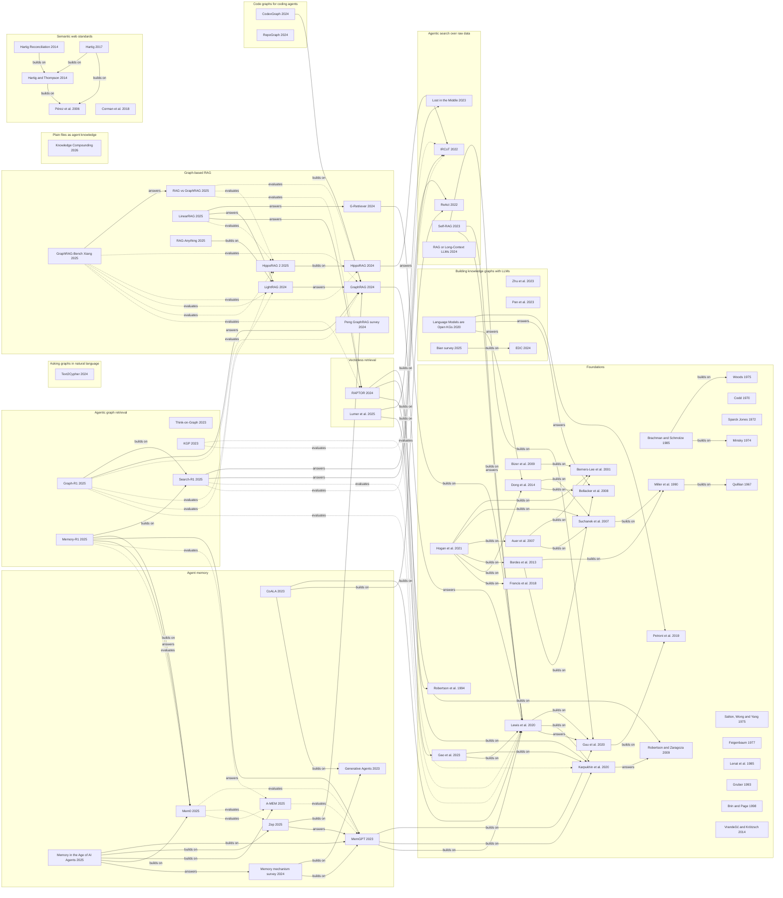

# Papers

Only the really fundamental papers on [knowledge graphs](../index/knowledge-graph.md) and [retrieval-augmented generation](../index/retrieval-augmented-generation.md) are listed here, grouped by the [trend](../trends/README.md) they belong to. One more group, Foundations, holds the papers that predate every current trend, from the semantic network of 1967 to the retrieval-augmented generation survey of 2023. Datasets and benchmarks have their own chapters, [Datasets](../datasets/README.md) and [Benchmarks](../benchmarks/README.md), so a paper whose main contribution is a dataset or a benchmark is not told here. Each group page has one section per paper, with the test it passes, the idea, its relations to other papers and how deeply it was read, then a list of further reading.

## How the papers were chosen

A paper is listed when it passes at least one of four tests (the owner's decision R-1) and a reader of the chapter would miss it. Everything else that passes a test goes to the further reading of its group, one line each.

| Test | What it asks | What the group pages do with it |
|---|---|---|
| Origin | Did the paper introduce the approach? | State the earlier-work search made for this page (an arXiv search of titles and abstracts on 20261102); where it finds an earlier paper that does the same, the claim is narrowed or dropped. A claim that is the authors' own is marked first-party |
| Turning point | Did it change what later work assumed or tested? | Name the later paper that extends it, runs it as a baseline, absorbs it or takes up its question. A paper cited only as corroboration, or built on only by its own author, does not pass and goes to the further reading |
| Widely built on | Do many later papers use it? | Give a citation count with its source and read time, and the later papers read that use it; where a group uses a threshold, the group page states it as its own choice and not a standard |
| Survey of record | Is it the survey to start from for its topic? | Name the survey and say why it is the one to start from |

Fourteen papers of the first edition of this chapter were moved to the further reading of their groups, because none of the four tests could be shown for them with a source: KAG, RAGSearch and BM25 Wins at Scale ([Graph-based RAG](graph-based-rag.md)); AutoSchemaKG ([Building knowledge graphs with LLMs](llm-kg-construction.md)); GraphRAG-R1 ([Agentic graph retrieval](learned-graph-traversal.md)); LogicRAG ([Vectorless retrieval](reasoning-over-structure.md)); Is Grep All You Need? and ReFind ([Agentic search over raw data](agentic-search.md)); Naive RAG Is Stronger ([Agent memory](agent-memory.md)); Vector RAG vs LLM Wiki and Filesystem-Based Memory ([Plain files as agent knowledge](plain-file-knowledge.md)); and AST-derived graphs, Codebase-Memory and Small coding agents ([Code graphs for coding agents](code-knowledge-graphs.md)). Each further-reading entry says why. For the papers of 2026 the reason is mostly the same: no paper read builds on them yet, and a paper cited once as corroboration does not pass. Four papers pass in a weak or provisional form and are marked as such: Text2Cypher, Lumer et al., the Bian survey and Corman et al. ([Semantic web standards](semantic-web-standards.md)). Foundations lists 29 papers, one more than the catalogue's 28: it keeps Robertson et al. 1994, the report in which BM25 appears, beside Robertson and Zaragoza 2009, the survey of the family that the catalogue named first.

What is not a paper of this chapter:

- **Datasets and benchmarks.** A paper whose main contribution is a dataset or a benchmark lives in chapters 5 and 6; the papers chapter names it only in relation lines. An evaluation study that reports a finding is a paper (for example RAG vs GraphRAG and GraphRAG-Bench Xiang). There are two exceptions. Text2Cypher is explained under the table of groups. The papers behind five knowledge bases (WordNet, YAGO, DBpedia, Freebase and Wikidata) stay in Foundations, because each presents a built system (its design, data model or construction method) and is a founding paper of the knowledge-graph story; the owner kept them after the review of 20261103. Their data facts (size, versions, licence) live on the [dataset pages](../datasets/README.md), not here.
- **Standards.** W3C and ISO documents are entries of the [index](../index/README.md) of kind standard. A paper behind a standard is not a standard: [Semantic web standards](semantic-web-standards.md) holds papers of that kind.
- **Blog posts and gists.** They are not papers. A group page names one in its introduction when it presents it as the origin or the earliest dated source it read for the line of work (the LazyGraphRAG post, the LLM Wiki gist and Aider's repository map are named this way).

Rules for the numbers and the wording:

- Citation counts are carried over from the candidate research with their source (Semantic Scholar, OpenAlex or Crossref) and the time they were read; the group pages record that the interfaces were rate-limited on 20261102, so the counts were not queried again. A count is never compared with a count from another source, and where there is none the page says **unstated**. On 20261103 OpenAlex answered and Semantic Scholar refused most requests (HTTP 429): the page Semantic web standards gives OpenAlex counts and, where Semantic Scholar answered, its counts too, each with its source.
- Earlier-work searches and checks of later papers were made for this page on 20261102 (22:56 to 23:17 UTC) against the arXiv API and the arXiv HTML renderings; they search titles, abstracts and the names in the rendered text, are not exhaustive, and are described in the sources of the group pages. For the group Semantic web standards the same kind of searches were made on 20261103 (09:25 to 09:41 UTC), against the arXiv API and the PDFs of the papers.
- Results reported by a method's own authors are marked first-party. A paragraph that judges starts with *Reading:*.
- Years are those of the first version or first publication, as in the section titles of the group pages, with two exceptions that follow the venue: Gruber (1993) is dated by the journal article, while the Stanford report is of 199209 [3]; Hogan et al. (2021) is dated by the journal issue, while the first arXiv version is 20200304 [4].

## The groups

One row per group: Foundations first, then the trends in the order of the [trends chapter](../trends/README.md). The count is the number of fundamental papers; further reading is not counted.

| Group | Trend | Fundamental papers | Earliest and latest year |
|---|---|---|---|
| [Foundations](foundations.md) | predates the trends | 29 | 1967 to 2023 |
| [Graph-based RAG](graph-based-rag.md) | [Graph-based RAG](../trends/graph-based-rag.md) | 10 | 2024 to 2025 |
| [Building knowledge graphs with LLMs](llm-kg-construction.md) | [Building knowledge graphs with LLMs](../trends/llm-kg-construction.md) | 5 | 2020 to 2025 |
| [Asking graphs in natural language](graph-query-generation.md) | [Asking graphs in natural language](../trends/graph-query-generation.md) | 1 | 2024 |
| [Agentic graph retrieval](learned-graph-traversal.md) | [Agentic graph retrieval](../trends/learned-graph-traversal.md) | 5 | 2023 to 2025 |
| [Vectorless retrieval](reasoning-over-structure.md) | [Vectorless retrieval](../trends/reasoning-over-structure.md) | 2 | 2024 to 2025 |
| [Agentic search over raw data](agentic-search.md) | [Agentic search over raw data](../trends/agentic-search.md) | 5 | 2022 to 2024 |
| [Agent memory](agent-memory.md) | [Agent memory](../trends/agent-memory.md) | 8 | 2023 to 2025 |
| [Plain files as agent knowledge](plain-file-knowledge.md) | [Plain files as agent knowledge](../trends/plain-file-knowledge.md) | 1 | 2026 |
| [Code graphs for coding agents](code-knowledge-graphs.md) | [Code graphs for coding agents](../trends/code-knowledge-graphs.md) | 2 | 2024 |
| [Semantic web standards](semantic-web-standards.md) | [Semantic web standards](../trends/semantic-web-standards.md) | 5 | 2006 to 2018 |
| **Total** | | **73** | **1967 to 2026** |

**Two groups have one paper, not the two the catalogue asked for; the owner decided on 20261103 to keep them as they are.** Asking graphs in natural language: Text2Cypher passes one test, "widely built on", on a small count (73 citations, Semantic Scholar, read 20261102 19:47 UTC), and later papers of the line use its data or cite it. No other candidate passed a test: Text2Cypher Across Languages has 3 citations and a narrow finding, SPARQL-LLM extends its authors' earlier system and no paper read cites it, and Text2GraphQuery-Bench is a benchmark paper ([group page](graph-query-generation.md)). Text2Cypher is also a dataset paper, which the rule above would send to chapters 5 and 6. Plain files as agent knowledge: Knowledge Compounding passes "origin" on arXiv timestamps, as the first paper on the gist; the other candidates were cited only as corroboration or by their own author, or are not first ([group page](plain-file-knowledge.md)). Both groups stay as they are: the owner chose to keep them rather than drop them or relax a test. Vectorless retrieval and Code graphs for coding agents have two papers each. Semantic web standards was added on 20261103, at the owner's review of this chapter, as a group made by the same four tests and not as an exception to the rule of one group per trend; its standards stay index entries, and its five papers, one of them older than every other trend, are told on its page.

## Map

Each box is a group and each node a fundamental paper, labelled with its short name and the year. An arrow runs from a paper to the paper it relates to and carries the kind of relation as the group pages use it: *builds on* (extends it, or uses its method or data; for a survey, covers it and cites it), *answers* (responds to a limit it names) and *evaluates* (tests it as a baseline or as the subject). Evaluations are dotted. Only relations between two fundamental papers are drawn, and only those that a source read states (see the last part of this section); relations to datasets, benchmarks, projects, further reading and papers without a section stay on the group pages. The diagram and the list below it were generated from the relation lines of the eleven group pages (one line per paper, in the form "Builds on: ... Answers: ... Evaluates: ..."), so they carry the same information and match the final set of papers.

### Relations as a list

The same relations without the diagram, one line per paper, grouped by the group of the paper on the left. The links lead to the group pages, where each relation is stated with its source. Both the diagram and this list were generated from the relation lines of the eleven group pages.

**Foundations**

- [Brachman and Schmolze 1985](foundations.md): builds on [Woods 1975](foundations.md), [Minsky 1974](foundations.md)
- [Miller et al. 1990](foundations.md): builds on [Quillian 1967](foundations.md)
- [Suchanek et al. 2007](foundations.md): builds on [Miller et al. 1990](foundations.md)
- [Auer et al. 2007](foundations.md): builds on [Berners-Lee et al. 2001](foundations.md), [Suchanek et al. 2007](foundations.md)
- [Bizer et al. 2009](foundations.md): builds on [Berners-Lee et al. 2001](foundations.md)
- [Bordes et al. 2013](foundations.md): builds on [Miller et al. 1990](foundations.md), [Bollacker et al. 2008](foundations.md)
- [Dong et al. 2014](foundations.md): builds on [Suchanek et al. 2007](foundations.md), [Bollacker et al. 2008](foundations.md)
- [Guu et al. 2020](foundations.md): builds on [Petroni et al. 2019](foundations.md)
- [Karpukhin et al. 2020](foundations.md): answers [Robertson and Zaragoza 2009](foundations.md)
- [Lewis et al. 2020](foundations.md): builds on [Guu et al. 2020](foundations.md), [Karpukhin et al. 2020](foundations.md); answers [Guu et al. 2020](foundations.md)
- [Hogan et al. 2021](foundations.md): builds on [Berners-Lee et al. 2001](foundations.md), [Suchanek et al. 2007](foundations.md), [Auer et al. 2007](foundations.md), [Bordes et al. 2013](foundations.md), [Dong et al. 2014](foundations.md), [Francis et al. 2018](foundations.md)
- [Gao et al. 2023](foundations.md): builds on [Karpukhin et al. 2020](foundations.md), [Lewis et al. 2020](foundations.md)

**Graph-based RAG**

- [G-Retriever 2024](graph-based-rag.md): builds on [Lewis et al. 2020](foundations.md)
- [GraphRAG 2024](graph-based-rag.md): answers [Lewis et al. 2020](foundations.md)
- [HippoRAG 2024](graph-based-rag.md): answers [IRCoT 2022](agentic-search.md)
- [LightRAG 2024](graph-based-rag.md): answers [GraphRAG 2024](graph-based-rag.md)
- [RAG vs GraphRAG 2025](graph-based-rag.md): evaluates [GraphRAG 2024](graph-based-rag.md), [HippoRAG 2 2025](graph-based-rag.md), [RAPTOR 2024](reasoning-over-structure.md)
- [HippoRAG 2 2025](graph-based-rag.md): builds on [HippoRAG 2024](graph-based-rag.md)
- [GraphRAG-Bench Xiang 2025](graph-based-rag.md): answers [RAG vs GraphRAG 2025](graph-based-rag.md); evaluates [GraphRAG 2024](graph-based-rag.md), [HippoRAG 2024](graph-based-rag.md), [LightRAG 2024](graph-based-rag.md), [HippoRAG 2 2025](graph-based-rag.md), [RAPTOR 2024](reasoning-over-structure.md)
- [LinearRAG 2025](graph-based-rag.md): answers [G-Retriever 2024](graph-based-rag.md), [LightRAG 2024](graph-based-rag.md), [RAPTOR 2024](reasoning-over-structure.md); evaluates [HippoRAG 2 2025](graph-based-rag.md)
- [RAG-Anything 2025](graph-based-rag.md): builds on [LightRAG 2024](graph-based-rag.md)

**Building knowledge graphs with LLMs**

- [Language Models are Open KGs 2020](llm-kg-construction.md): answers [Petroni et al. 2019](foundations.md), [Bollacker et al. 2008](foundations.md), [Dong et al. 2014](foundations.md)
- [Bian survey 2025](llm-kg-construction.md): builds on [EDC 2024](llm-kg-construction.md)

**Agentic graph retrieval**

- [KGP 2023](learned-graph-traversal.md): evaluates [Karpukhin et al. 2020](foundations.md), [IRCoT 2022](agentic-search.md)
- [Search-R1 2025](learned-graph-traversal.md): answers [ReAct 2022](agentic-search.md), [IRCoT 2022](agentic-search.md); evaluates [Lewis et al. 2020](foundations.md), [IRCoT 2022](agentic-search.md)
- [Graph-R1 2025](learned-graph-traversal.md): builds on [Search-R1 2025](learned-graph-traversal.md); answers [GraphRAG 2024](graph-based-rag.md); evaluates [GraphRAG 2024](graph-based-rag.md), [LightRAG 2024](graph-based-rag.md), [HippoRAG 2 2025](graph-based-rag.md), [Lewis et al. 2020](foundations.md)
- [Memory-R1 2025](learned-graph-traversal.md): builds on [Search-R1 2025](learned-graph-traversal.md), [Mem0 2025](agent-memory.md); answers [MemGPT 2023](agent-memory.md), [Mem0 2025](agent-memory.md); evaluates [A-MEM 2025](agent-memory.md), [Mem0 2025](agent-memory.md)

**Vectorless retrieval**

- [RAPTOR 2024](reasoning-over-structure.md): builds on [Robertson et al. 1994](foundations.md), [Robertson and Zaragoza 2009](foundations.md), [Karpukhin et al. 2020](foundations.md)
- [Lumer et al. 2025](reasoning-over-structure.md): builds on [Lost in the Middle 2023](agentic-search.md), [Gao et al. 2023](foundations.md)

**Agentic search over raw data**

- [Self-RAG 2023](agentic-search.md): builds on [Guu et al. 2020](foundations.md), [Lewis et al. 2020](foundations.md); answers [Lewis et al. 2020](foundations.md)

**Agent memory**

- [CoALA 2023](agent-memory.md): builds on [Lewis et al. 2020](foundations.md), [ReAct 2022](agentic-search.md), [Generative Agents 2023](agent-memory.md)
- [MemGPT 2023](agent-memory.md): builds on [Guu et al. 2020](foundations.md), [Karpukhin et al. 2020](foundations.md), [Lewis et al. 2020](foundations.md)
- [Memory mechanism survey 2024](agent-memory.md): builds on [Generative Agents 2023](agent-memory.md), [MemGPT 2023](agent-memory.md)
- [Zep 2025](agent-memory.md): builds on [GraphRAG 2024](graph-based-rag.md); answers [MemGPT 2023](agent-memory.md)
- [A-MEM 2025](agent-memory.md): evaluates [MemGPT 2023](agent-memory.md)
- [Mem0 2025](agent-memory.md): evaluates [MemGPT 2023](agent-memory.md), [Zep 2025](agent-memory.md), [A-MEM 2025](agent-memory.md)
- [Memory in the Age of AI Agents 2025](agent-memory.md): builds on [MemGPT 2023](agent-memory.md), [Zep 2025](agent-memory.md), [A-MEM 2025](agent-memory.md), [Mem0 2025](agent-memory.md); answers [Memory mechanism survey 2024](agent-memory.md)

**Code graphs for coding agents**

- [CodexGraph 2024](code-knowledge-graphs.md): builds on [GraphRAG 2024](graph-based-rag.md)

**Semantic web standards**

- [Hartig and Thompson 2014](semantic-web-standards.md): builds on [Pérez et al. 2006](semantic-web-standards.md)
- [Hartig Reconciliation 2014](semantic-web-standards.md): builds on [Hartig and Thompson 2014](semantic-web-standards.md)
- [Hartig 2017](semantic-web-standards.md): builds on [Hartig and Thompson 2014](semantic-web-standards.md), [Pérez et al. 2006](semantic-web-standards.md)

### Relations not drawn

Left out of the diagram, the list and the relation lines, with the reason:

- **By subject only.** The group page links the two papers on its own reading, and no source read says that the first cites the second: Woods 1975 and Quillian 1967; Lenat et al. 1985 and Feigenbaum 1977 (the Cyc title names the bottleneck that Feigenbaum names); Brin and Page 1998 and Salton, Wong and Yang 1975 (named, not cited); IRCoT 2022 and Lewis et al. 2020 (the abstract does not name it); LinearRAG 2025 and HippoRAG 2024 (the same ranking algorithm).
- **Pages that disagree.** Petroni et al. 2019 and Vrandečić and Krötzsch 2014: the first page says Petroni answers the structured knowledge base, the second says Petroni uses Wikidata for its probes, and no source read shows that Petroni cites the Wikidata paper.
- **Citation only.** A paper that only cites another in its related work is not drawn (for example Think-on-Graph and ReAct, Pan et al. 2023 and Petroni et al. 2019, the Bian survey and Pan et al. 2023 or Zhu et al. 2023, and RAG or Long-Context LLMs and Lost in the Middle).
- **A survey's relation that its page does not state.** Hogan et al. 2021 cite Hartig 2017 (for RDF\*), Hartig and Thompson 2014 and Corman et al. 2018 (for recursive shapes) [9]. For a survey a covered, cited paper is a *builds on* relation, but the relation line of Hogan et al. on the Foundations page does not list these three, so they are not drawn; the Foundations page was not changed when Semantic web standards was added.
- **Not a paper of the chapter.** A project, a blog post or a paper in the further reading is written in plain words after "also:" in the relation line and is not drawn (PageIndex for Lumer et al., Aider's repository map for RepoGraph, the Mem0 repository for A-MEM, StructGPT and MDR for Think-on-Graph and KGP, ORQA for REALM, DPR and RAG, Singleton Property and the named-graph study for Hartig 2017). The host system "RAG" of RepoGraph is the generic BM25 baseline of SWE-bench, not the paper by Lewis et al.

Five relations were checked for this page against the papers' texts, and the group pages state them as drawn here:

- Karpukhin et al. 2020 answers Robertson and Zaragoza 2009: DPR cites the monograph for BM25 and cites no other BM25 paper [1].
- RAPTOR 2024 builds on Robertson et al. 1994 and on Robertson and Zaragoza 2009: its reference list holds Okapi at TREC-3 and the monograph [2].
- G-Retriever 2024 builds on Lewis et al. 2020: it cites that paper as the proposal of retrieval-augmented generation [5].
- RAG vs GraphRAG 2025 evaluates HippoRAG 2 only in version 3: version 1 predates HippoRAG 2 (20250217 against 20250220) [4][6].
- Hartig and Thompson 2014 and Hartig 2017 build on Pérez et al. 2006 through its journal article: both cite "ACM Transactions on Database Systems, 34(3), 2009" [8], and the Semantic Scholar record of that article carries the arXiv id of the 2006 text [7]. The SPARQL 1.0 Recommendation links the arXiv text as its reference "Semantics of SPARQL"; the journal article is longer (45 pages against 27), and whether its wording is the same is unstated; the group page reads the arXiv text only.

## Changes

The latest changes to this chapter, newest first, come from the chapter's list of changes.

<!-- BEGIN GENERATED: changes -->

| Date | Kind | Subject | Summary | Source |
|---|---|---|---|---|
| 20261103 | updated | chapter rules | The owner reviewed the list: both one-paper groups stay (Text2Cypher; Knowledge Compounding), and the papers behind WordNet, YAGO, DBpedia, Freebase and Wikidata stay in Foundations as a named exception to the rule on dataset papers. | docs/papers/README.md |
| 20261103 | added | Semantic web standards | New group of 5 fundamental papers for the trend Semantic web standards, added at the owner's review: the formal semantics of SPARQL (2006), three papers of the RDF-star line (2014, 2014, 2017) and a semantics of recursive SHACL (2018, a weak pass). The chapter now has 73 fundamental papers in 11 groups. | docs/papers/semantic-web-standards.md |
| 20261102 | added | chapter | First edition: 68 fundamental papers in 10 groups (Foundations with 29 papers, then one group per trend) and a map of how they build on, answer or evaluate each other. | docs/papers/README.md |

Full list: [changes.tsv](changes.tsv)

<!-- END GENERATED: changes -->

## Sources

Every other statement about a paper is made, with its source, on the group page it links to. The sources below support what this page states itself.

1. <https://arxiv.org/pdf/2004.04906> : Karpukhin et al., text and reference list: "Robertson and Zaragoza, 2009" for BM25, no other BM25 reference (read 20261102 21:45 UTC)
2. <https://arxiv.org/html/2401.18059v1> : RAPTOR (version 1), text and reference list: BM25 cited as Robertson et al. 1995 (Okapi at TREC-3) and Robertson et al. 2009 (fetched 20261102 21:31 UTC, searched again 21:46 UTC)
3. <https://tomgruber.org/writing/ontolingua-kaj-1993.pdf> and <https://api.crossref.org/works/10.1006/knac.1993.1008> : Gruber, Stanford report KSL 92-71 of September 1992, revised April 1993, appeared in Knowledge Acquisition 5(2), issue 1993-06 (read 20261102 21:49 UTC)
4. <https://export.arxiv.org/api/query?id_list=2003.02320,2502.11371,2502.14802> : first-version dates 20200304 (Hogan et al.; journal reference ACM Computing Surveys 54(4), 2021), 20250217 (RAG vs GraphRAG) and 20250220 (HippoRAG 2) (read 20261102 21:48 UTC)
5. <https://arxiv.org/pdf/2402.07630> : G-Retriever, text and reference list: "initially proposed by Lewis et al." with the 2020 RAG paper as reference 21 (read 20261102 21:47 UTC; searched for this passage, not read end to end)
6. <https://arxiv.org/html/2502.11371v3> and <https://arxiv.org/pdf/2502.11371v1> : RAG vs GraphRAG, version 3 selects HippoRAG2 as a representative method; the text of version 1 has no mention of it (read 20261102 21:48 UTC)
7. <https://api.semanticscholar.org/graph/v1/paper/ARXIV:cs/0605124> : record of Pérez, Arenas and Gutierrez, "Semantics and complexity of SPARQL": venue TODS, DOI 10.1145/1567274.1567278, arXiv id cs/0605124, DBLP key journals/tods/PerezAG09 (read 20261103 09:27 UTC)
8. <https://arxiv.org/pdf/1406.3399v3> and <http://ceur-ws.org/Vol-1912/paper12.pdf> : Hartig and Thompson, reference "[PAG09] Jorge Pérez, Marcelo Arenas, and Claudio Gutierrez. Semantics and Complexity of SPARQL. ACM Transactions on Database Systems, 34(3), 2009"; Hartig (2017), reference 7, the same article (read 20261103 09:24 and 09:26 UTC)
9. <https://arxiv.org/pdf/2003.02320v6> : Hogan et al., "Knowledge Graphs": RDF\* [218] = Hartig (2017); [17, 222] with [222] = Hartig and Thompson (2014); partial assignments [104] = Corman, Reutter, Savković (2018); searched with a script, not read end to end (read 20261103 09:30 UTC)
