# Trends: what the field is doing now

This chapter holds the families of approach to [knowledge graphs](../index/knowledge-graph.md), [retrieval-augmented generation](../index/retrieval-augmented-generation.md) (RAG) and [agent memory](../index/agent-memory.md) that are still moving. Nine pages are families, each told as a shift from one way of doing something to another; two are themes, on the infrastructure underneath (including the [Model Context Protocol](../index/model-context-protocol.md), MCP) and on graph features that projects removed or added. What has settled is in chapter 1, [History](../history/README.md); a trend that settles moves there, with a dated row in the changes list at the foot of this page. The list was fixed on 20261102 and is updated on request [1].

## How the trends were chosen

Two tests decided which families get a page [1].

- **Sustained activity.** The family has active projects in the GitHub snapshot of 20261030 19:54 UTC (pushed within 90 days, not archived), or a rising count of on-topic papers in the window 20251102 to 20261102 against the year before [1].
- **Distinctness.** No other trend covers the idea. It differs from its nearest neighbour in what is built or stored, when a model is used, or who steers retrieval [1].

The two themes were added by the owner when the list was fixed (the trend pages call this decision T-2). They are not families, so the distinctness test does not apply to them [12][13].

Paper counts are keyword hits in the arXiv API, not counts of papers in the field. Each is read against three controls over the same two windows: any [large language model](../index/large-language-model.md) (LLM) wording (x1.38), any RAG wording (x1.23) and LLM-agent wording (x2.50) [2]. A family is `growing` when its activity rises faster than the controls, `steady` when it is sustained near them, and `settling` when parts have become standard or been absorbed; no trend is `settling` yet [1].

*Reading:* the status is a judgement, not a formula. Graph-based RAG papers rise faster than the RAG and LLM controls but slower than the agent control, while Microsoft's flagship project, [Microsoft GraphRAG](../projects/microsoft-graphrag.md), is in maintenance mode, so it is called `steady` [3]. Of the six `growing` calls, five rest on small or noisy counts, and their pages say so: agentic graph retrieval, vectorless retrieval, agentic search, plain files and code graphs [6][7][8][10][11]. Agent memory's page calls neither its paper count (482 against 53) nor its repository count noisy; it calls the repository count a lower bound [9].

The table gives each trend's results on the two tests, as its page reports them.

| Trend | Test 1: activity, as the page reports it | Test 2: nearest neighbour and the difference |
|---|---|---|
| Graph-based RAG | Papers 255 against 148 (x1.72; the catalogue's earlier run gives x1.63); 20 active repositories by hand tag ([list](../../plans/evidence/trends-hand-tags-of-the-snapshot.txt)); Microsoft GraphRAG README says "largely in maintenance mode" (re-read 20261102 21:29 UTC) [3] | Building knowledge graphs with LLMs: same extraction step, but here the graph is an index. Code graphs: a parser builds the graph |
| Building knowledge graphs with LLMs | Papers 75 against 64 (x1.17), below the LLM control (x1.38) [4] | Graph-based RAG: here the typed graph or ontology is the asset, judged against human schemas |
| Asking graphs in natural language | Papers 52 against 38 (x1.37), tracking the LLM control; a named `Text2CypherRetriever` (a retriever that has a model write [Cypher](../index/cypher.md) queries) in [Neo4j's GraphRAG package](../projects/neo4j-graphrag-python.md) [5] | Agentic graph retrieval: translate once and the engine runs the query, instead of a model walking the graph |
| Agentic graph retrieval | Keyword hits 44 against 18; by title on topic 5 against 12; no active repository at the snapshot [6] | Vectorless retrieval: a trained policy walks a graph, not a prompted model a tree |
| Vectorless retrieval | [PageIndex](../projects/pageindex.md) 39,913 stars at the snapshot of 20261030 19:54 UTC, last push 20261029; papers 19 against 4, about half off-topic [7] | Plain files: a model reads pages it wrote. Agentic search: nothing is built |
| Agentic search over raw data | Probe 151 against 26 (x5.8, also catches web-search agents); no snapshot row has it as its mechanism [8] | Vectorless retrieval builds a tree; code graphs build a parsed graph, against grep |
| Agent memory | Papers 482 against 53 (x9.1) against an agent control of x2.5; 199 active repositories in the snapshot's category, a lower bound [9] | Plain files: extracted records in a store, not files; graph-based RAG: sessions write to the store |
| Plain files as agent knowledge | Papers on LLM wikis 21 against 0, on context files 59 against 2; 20 of 48 April-2026 repositories still active [10] | Agent memory: files are the source of truth; vectorless retrieval: here the model writes the pages |
| Code graphs for coding agents | Papers 13 against 1, about 5 of 13 on topic; four of six projects flagged fast-growth (re-read 20261102 21:29 UTC); 28 active repositories by hand tag ([list](../../plans/evidence/trends-hand-tags-of-the-snapshot.txt)) [11] | Graph-based RAG: a graph without a model; agentic search: grep |
| Infrastructure and MCP | Theme. MCP hits x2.8; graph-database hits x0.8; vector-database hits x1.2 [12] | None: it holds no retrieval method |
| Graph features removed and added | Theme. Ten dated removals or demotions and seven additions, from eleven chosen repositories [13] | None: it follows acts across families |

The catalogue gives about 117 active repositories for agent memory; the page's recount of the snapshot gives 199, and the page is used [1][9]. It gives 9 for graph construction, which that page does not repeat [1][4].

### What was merged, and why

| Merged item | Now a section of | Reason, from the page |
|---|---|---|
| Cheaper or lazy construction; multimodal graph RAG; hypergraph variants | [Graph-based RAG](./graph-based-rag.md) | Still a graph used as an index; only how it is built, its node types or its edges differ, and [LightRAG](../projects/lightrag.md) absorbed the multimodal work [3] |
| Schema and ontology induction; ontology-grounded context graphs | [Building knowledge graphs with LLMs](./llm-kg-construction.md) | Induction changes where the schema comes from, not what is stored, so it fails test 2 alone; context graphs build a typed graph under an ontology [4] |
| Text-to-SPARQL challenges | [Asking graphs in natural language](./graph-query-generation.md) | Same mechanism: translate once, the engine executes; only the target language ([SPARQL](../index/sparql.md)) differs [5] |
| Reinforcement-learned controllers for memory operations | [Agentic graph retrieval](./learned-graph-traversal.md) | Same technique and claim: a policy rewarded on task success ([reinforcement learning](../index/reinforcement-learning.md)); what is stored is agent memory's business [6] |
| Temporal knowledge graphs; write policies; governed and attacked memory | [Agent memory](./agent-memory.md) | Time is a design axis of all memory; the write choice separates memory from retrieval; governance acts on the same store [9] |
| LLM wikis; context files; skills; knowledge compilation; the Open Knowledge Format | [Plain files as agent knowledge](./plain-file-knowledge.md) | The model reads or writes files instead of querying a store [10] |
| Graph databases and standards; vector indexes in relational databases; MCP; RAG platforms | [Infrastructure and MCP](./infrastructure-and-mcp.md) | The layer under the other trends [12] |
| Dated removals and additions of graph features | [Graph features removed and added](./features-in-and-out.md) | A record of acts across projects, whatever their family [13] |

Not trends of their own: evaluation and licensing. They are two columns of the table below and a section ("What is measured, and by whom") on every trend page (the trend pages call this decision T-6) [1].

## The trends at a glance

Each row is taken from the page its first cell links to, which is the source number in brackets; the page has the full figures and their sources. "First-party" means the project's or method's own authors. A cell says **unstated** or "none found" where the page does.

| Trend | Shift | Built or stored | When a model is used | Who steers retrieval | Cost profile | Evidence | Licences | Status |
|---|---|---|---|---|---|---|---|---|
| [Graph-based RAG](./graph-based-rag.md) [3] | Eager LLM-built graphs -> cheaper, lazier ones | Entity-relation graph as the retrieval index, optionally with model-written community reports | At index time (extract, summarise); the shift moves or removes those calls | The retrieval algorithm (neighbourhood, community summaries, [Personalized PageRank](../index/personalized-pagerank.md)) | Grows with the corpus; extraction about 75% of GraphRAG indexing (Microsoft); [MultiHop-RAG](../datasets/multihop-rag.md) build 135 s plain RAG, 5,560 s Community-GraphRAG (Han et al.) | Mostly first-party cost claims; independent: plain RAG level or ahead on single-hop, graphs ahead on [multi-hop](../index/multi-hop-question-answering.md) | MIT: Microsoft GraphRAG, LightRAG, [HippoRAG](../projects/hipporag.md), [RAG-Anything](../projects/rag-anything.md). Apache-2.0: [GraphRAG SDK](../projects/graphrag-sdk.md), neo4j-graphrag. LinearRAG, LogicRAG: GPL-3.0, read-only | steady |
| [Building knowledge graphs with LLMs](./llm-kg-construction.md) [4] | Fixed schemas -> induced ones | A typed graph or ontology kept as an asset | At build time only: extraction, schema induction, canonicalisation | Not a retrieval design; a person reviews the schema, or an agent drafts it | Model calls per chunk at build time; no cost figure on the page | First-party only; no independent induced-versus-human comparison found | Apache-2.0: [LLM Graph Builder](../projects/llm-graph-builder.md), [GLiNER](../projects/gliner.md). BSD-3-Clause: [OntoGPT](../projects/ontogpt.md). [Hyper-Extract](../projects/hyper-extract.md): Apache-2.0 text, GitHub reports NOASSERTION | steady |
| [Asking graphs in natural language](./graph-query-generation.md) [5] | Hand-written queries -> model-written Cypher and SPARQL | Nothing: the existing graph stays | At query time, once per question; research adds repair loops | The model writes the query from a schema description; the engine runs it | No index; one model call per question plus retries | All scores first-party; no independent replication found | Apache-2.0 with some files under the PSF (Python Software Foundation) licence: neo4j-graphrag. MIT: [Code-Graph-RAG](../projects/code-graph-rag.md). CC0-1.0: Neo4j Labs text2cypher | steady |
| [Agentic graph retrieval](./learned-graph-traversal.md) [6] | One-shot lookup -> learned multi-turn traversal | A graph built beforehand or an existing one such as Freebase; the policy is trained, not stored | At query time over several turns; also in training | A model trained with [GRPO](../index/grpo.md), a reinforcement-learning method, picks each step; the reward is mainly the final answer | Graph still built up front; Graph-R1 query 7.0 s and $0 generation cost against 9.6 s and $8.76 per 1,000 queries for HyperGraphRAG (first-party, 2Wiki; whether training hardware is counted: unstated) [14] | Mostly first-party; outside: training-free GraphSearch above trained Graph-R1 on three multi-hop sets; a graph tool lowered an agent's [STaRK](../benchmarks/stark.md)-Prime Hit@1 (whether the first result is correct) from 0.6881 to 0.6055 | MIT: Graph-R1, GraphWalker, GraphRAG-R1. Apache-2.0: GraphSearch, Search-R1. youtu-graphrag: custom, academic use only, read-only | growing (papers only; small, noisy counts) |
| [Vectorless retrieval](./reasoning-over-structure.md) [7] | Similarity search -> a model reasoning over a document tree | A tree from the document's layout, mostly without a model; a model writes summaries | At query time: a prompted model reads node titles, opens nodes, repeats | The model, in an agent loop over the tree | About $0.001 per page to index (first-party), but a strong model on every question ($110 per 1,000 queries in the vendor cookbook) | Mostly first-party; outside tests mixed to weak for trees: vector agentic RAG won 68% of [LLM-judged](../index/llm-as-judge.md) pairwise comparisons in Lumer et al. [15]; no accuracy gain on FRAMES in a test by the [RAGFlow](../projects/ragflow.md) team | MIT: PageIndex. Apache-2.0: RAGFlow, OpenKB, KITE. LogicRAG: GPL-3.0, read-only | growing (low confidence) |
| [Agentic search over raw data](./agentic-search.md) [8] | Building structure -> letting the agent search | Nothing semantic: the raw record plus grep or a lexical index | At query time only | The agent | No index bill, but 39 times [BM25](../index/bm25.md)'s query tokens at the smallest tier and 895K tokens per question for the raw-file agent at full scale | Papers only, mostly first-party; BM25 leads the one scaling study at scale (Wang et al.) [16] | Tools only: Claude Code all rights reserved; codex, gemini-cli, Search-R1 Apache-2.0; pi-serini MIT; RAGFlow Apache-2.0 | growing (papers only; noisy count) |
| [Agent memory](./agent-memory.md) [9] | Retrieving documents -> remembering across sessions | Extracted fact records, graphs with validity windows, or notes and files written after each session | At write time to extract and consolidate (one call per add in [Mem0](../projects/mem0.md)); [Cognee](../projects/cognee.md) states ingestion and retrieval work without an LLM | A fixed pipeline in Mem0 and [Graphiti](../projects/graphiti.md); the agent itself in [Letta](../projects/letta.md), A-MEM and [MIRIX](../projects/mirix.md) | A model call per write in the extraction designs; the best published Mem0 scores use its hosted platform; otherwise unstated | Mostly first-party on [LoCoMo](../datasets/locomo.md) and [LongMemEval](../datasets/longmemeval.md); independent: plain retrieval level or ahead ([MemoryAgentBench](../benchmarks/memoryagentbench.md) overall: long-context 42.2, BM25 41.5, Mem0 21.1) | Apache-2.0: [claude-mem](../projects/claude-mem.md) (AGPL-3.0 from 20250911 to 20260508), Mem0, Cognee, Graphiti, Letta, [MemOS](../projects/memos.md), MIRIX (MIT before 20250711). MIT: [Hindsight](../projects/hindsight.md). AGPL-3.0: [OpenViking](../projects/openviking.md) (Apache-2.0 before 20260330) | growing |
| [Plain files as agent knowledge](./plain-file-knowledge.md) [10] | Databases and indexes -> Markdown the model maintains | Model-written, linked Markdown pages plus `index.md` and `log.md`; any search index is a derived cache | At ingest (compile), query (navigate) and lint; none at storage | The agent reads the index, then opens pages | Paid at ingest, then reading per query; one small preregistered study found about 21 times vector RAG's query tokens | First-party for the projects; a few small third-party studies, mixed, none at scale | MIT: [claude-obsidian](../projects/claude-obsidian.md), [Tigerless agent-memory](../projects/tigerless-agent-memory.md). Apache-2.0: Letta, EverOS, OKF (Open Knowledge Format). AGPL-3.0: [Basic Memory](../projects/basic-memory.md), OpenViking. [llm-wiki-nashsu](../projects/llm-wiki-nashsu.md): GPL-3.0, read-only | growing (small base) |
| [Code graphs for coding agents](./code-knowledge-graphs.md) [11] | Grep and file reads -> parsed code graphs | A graph of definitions and calls from a tree-sitter parser, in SQLite or JSON | No LLM to index code in five of six projects; the agent's own model steers by calling tools | The coding agent, by choosing graph tools (MCP, command line or skill) | No LLM tokens to build; reported query savings (62% fewer tokens, about 10 times fewer) are first-party | All six projects first-party; the one quality comparison against a file-reading baseline favours the baseline (0.83 against 0.92); no independent evaluation found | MIT: [CodeGraph](../projects/codegraph.md), [codebase-memory-mcp](../projects/codebase-memory-mcp.md), [code-review-graph](../projects/code-review-graph.md), Code-Graph-RAG, [Understand Anything](../projects/understand-anything.md). Apache-2.0: [Graphify](../projects/graphify.md), since 20260722 | growing (small, noisy count) |
| [Infrastructure and MCP](./infrastructure-and-mcp.md) [12] | Vector-only stores and custom connectors -> vector indexes inside existing databases and one protocol | Not a retrieval method: graph databases, embedded stores, vector indexes in relational databases, MCP servers | Not applicable to storage; an agent calls MCP tools when it queries | The agent calls tools; the host controls authorization | Bulk ingest ranged 5.0k to 4.3M rows/s across eight engines (first-party in part) | MCP hits x2.8 (440 against 159), graph database x0.8, vector database x1.2; three 2026 studies, all first-party at least in part | GPL-3.0: [Neo4j](../projects/neo4j.md) Community. [FalkorDB](../projects/falkordb.md): the Server Side Public License v1 then the Elastic License 2.0 in one file. [Memgraph](../projects/memgraph.md): Business Source License 1.1 and the Memgraph Enterprise License. [MCP servers](../projects/mcp-servers.md): Apache-2.0 for new work. [LlamaIndex](../projects/llama-index.md): MIT. [Dify](../projects/dify.md): modified Apache 2.0 | steady |
| [Graph features removed and added](./features-in-and-out.md) [13] | Theme: none (n/a) | Varies by project | Several additions cut model use at extraction (local GLiNER, spaCy, one call instead of two) | Not a retrieval design | Extraction cost is one lever of the additions; removals mostly give no reason | First-party only for the features; independent studies test graphs in general | Apache-2.0 (7 of 11 repositories), MIT (3), AGPL-3.0 (1), from the LICENSE files | steady |

## How they relate

Neighbouring trends share one of three axes and differ on another.

- **What is built before the question.** A model-built graph (graph-based RAG, graph construction), a parser-built graph (code graphs), a layout tree (vectorless retrieval), model-written pages (plain files), records written after sessions (agent memory), or nothing (agentic search; asking graphs, where the graph already exists).
- **Who steers retrieval.** A fixed algorithm (graph-based RAG, Mem0 and Graphiti), a database engine running one model-written query (asking graphs), a prompted model (vectorless retrieval, agentic search, code graphs through tool choice) or a trained policy (agentic graph retrieval).
- **When a model is used.** At index time (graph-based RAG, graph construction), at query time (asking graphs, vectorless retrieval, agentic search), at write time (agent memory), or at ingest and query (plain files).

```mermaid
flowchart LR
    GBR["Graph-based RAG"]
    KGC["Building knowledge graphs with LLMs"]
    GQG["Asking graphs in natural language"]
    LGT["Agentic graph retrieval"]
    ROS["Vectorless retrieval"]
    AGS["Agentic search"]
    MEM["Agent memory"]
    PFK["Plain files"]
    CKG["Code graphs"]
    INF["Infrastructure and MCP"]
    FIO["Features in and out"]

    GBR ---|"graph as index vs graph as asset"| KGC
    GBR ---|"model builds the graph vs parser builds it"| CKG
    GBR ---|"corpus index vs store written by sessions"| MEM
    GBR ---|"model builds the graph vs graph already exists"| GQG
    GBR ---|"build a graph vs reason over a tree"| ROS
    GQG ---|"one query the engine runs vs a policy walking the graph"| LGT
    LGT ---|"trained policy on a graph vs prompted model on a tree"| ROS
    LGT ---|"learned memory controllers vs fixed write rules"| MEM
    ROS ---|"tree from layout vs pages the model writes"| PFK
    ROS ---|"a tree is built vs nothing is built"| AGS
    AGS ---|"grep vs parsed graph"| CKG
    AGS ---|"raw archive searched vs extracted records"| MEM
    AGS ---|"nothing built vs wiki compiled in advance"| PFK
    MEM ---|"extracted records vs files as source of truth"| PFK
    CKG ---|"model writes Cypher over a parsed code graph"| GQG
    INF ---|"where an index lives vs how it is built"| GBR
    INF ---|"protocol that reaches the store"| MEM
    INF ---|"protocol that reaches the graph"| CKG
    FIO ---|"dated acts across families"| GBR
    FIO ---|"dated acts across families"| MEM
    FIO ---|"acts on features vs the layer they run on"| INF
```

The same relations as a list, for readers without Mermaid. Each of the 21 pairs is named on at least one of the two trend pages, checked against their links and text on 20261102 21:49 UTC [3] to [13]. Thirteen are named on both pages. The eight named on one page only say which one.

- Graph-based RAG and building knowledge graphs with LLMs: the extraction step is the same; the graph is an index in one and the product in the other.
- Graph-based RAG and code graphs: a model builds the graph in one, a parser in the other.
- Graph-based RAG and agent memory: a corpus indexed in batches against a store that sessions write to.
- Graph-based RAG and asking graphs: one builds its graph with a model, the other queries a graph that already exists (named on the asking-graphs page only).
- Graph-based RAG and vectorless retrieval: two answers to the weakness of similarity search, a graph and a tree.
- Asking graphs and agentic graph retrieval: one query that the engine runs, against a trained policy that walks the graph (named on the asking-graphs page only).
- Agentic graph retrieval and vectorless retrieval: a trained policy on a graph, against a prompted model on a tree.
- Agentic graph retrieval and agent memory: learned memory controllers are filed with the first; the store belongs to the second.
- Vectorless retrieval and plain files: a tree taken from the layout, against pages a model writes.
- Vectorless retrieval and agentic search: a tree is built in one; nothing is built in the other.
- Agentic search and code graphs: grep against a parsed graph.
- Agentic search and agent memory: a raw archive that is searched, against records that are extracted.
- Agentic search and plain files: nothing built, against a wiki compiled in advance (named on the agentic-search page only).
- Agent memory and plain files: extracted records in a store, against files as the source of truth.
- Code graphs and asking graphs: Code-Graph-RAG has a model write Cypher over a parsed code graph (named on the code-graphs page only).
- Infrastructure and MCP with graph-based RAG, agent memory and code graphs: where an index lives, and the protocol that reaches it (three pairs, each named on the infrastructure page only).
- Features in and out with agent memory: dated acts on the features of that family (named on both pages).
- Features in and out with infrastructure: acts on features against the layer they run on (named on both pages).
- Features in and out with graph-based RAG: dated acts on the features of that family (named on the features page only).

## Readings across the trends

*Reading:* **Where the results come from outside the method's own authors, a plain baseline is often level or ahead; but the figures differ in who ran them and how they were scored.** The table says which is which.

| Figure | Run by | Scored how |
|---|---|---|
| Plain RAG matched or beat graph RAG on single-hop questions; graphs led on multi-hop [3] | Han et al., an independent comparison [18] | F1 (a score that balances precision and recall) on [Natural Questions](../datasets/natural-questions.md) and [HotpotQA](../datasets/hotpotqa.md), accuracy on MultiHop-RAG |
| BM25 led at every larger shared tier, 50.5 against 30.7 at full scale [8][16] | Wang et al., on a synthetic enterprise corpus | The study's own judge |
| The same agent with BM25 search scored 69.4 against 36.9 for raw files [8][16] | The same authors, a 150-question control on their own agent | One shared rejudge for that control |
| Vector agentic RAG won 68% of comparisons against node trees [7][15] | Lumer et al., a third party with a tree system of their own | LLM-as-judge, pairwise, on a 75-question subset |
| BM25 41.5 against Mem0 21.1 on one benchmark's overall column [9] | MemoryAgentBench's authors, who report all systems | Overall column of its Table 3 [19]; the per-task metrics are unstated here |
| Training-free GraphSearch above trained Graph-R1 on three multi-hop sets [6] | [RAGSearch](../benchmarks/ragsearch.md) authors, 7B backbones [20] | Contain exact match (Contain-EM), their Table 1 |
| An agent's STaRK-Prime Hit@1 fell from 0.6881 to 0.6055 with a graph tool [6] | Chen et al., tools prompted, not trained [21] | Hit@1, one dataset |

Exceptions: graphs led on multi-hop sets [3][6], and structured tools doubled grep-only accuracy for two small models in one single-author study [11].

*Reading:* **Most numbers are first-party.** Every score on the query-generation page, every result on the graph-construction page and all six code-graph projects' figures are the authors' own [5][4][11]. The features page found no before-and-after test of any removal or addition [13]. The independent studies the pages cite are mostly preprints, many read at abstract level [3][6][9].

*Reading:* **Cost moves; it rarely vanishes.** Graph-based RAG's levers move model calls from index time to query time [3]. A tree costs about $0.001 a page to index and $110 per 1,000 queries to answer [7]. Raw search has no index bill and 39 times BM25's query tokens at the smallest tier [8]. A compiled wiki paid about 21 times vector RAG's query tokens in one small study [10]. Asking graphs needs no index and one model call per question [5]. No source read compares the cheap routes at matched cost on one corpus [3][7].

*Reading:* **Files, protocols and hosted tiers recur.** Files are the medium of plain-file knowledge and of two memory designs (OpenViking's virtual filesystem and Anthropic's memory tool directory) [9][10]. MCP is how agents reach memory servers and code graphs [11][12]. Graph features sit behind hosted tiers: Mem0's graph memory is Platform-only and Graphify leads with Graphify Cloud [11][13]. Mem0's README says its best scores reflect its managed platform, so the open code may not equal what a vendor reports [9][13]. A different case: LLM Graph Builder's banner says it is no longer actively developed and points to a hosted successor in Aura, a deprecation notice rather than a feature moved behind a tier [13][17].

*Reading:* **Papers and repositories do not always agree.** Agentic graph retrieval and agentic search have papers and no active project [6][8]. Graph-based RAG papers rise while Microsoft's flagship is in maintenance mode [3]. Of 48 April-2026 wiki repositories, 28 were quiet at the snapshot [10]. Code graphs have large, fast-growing projects and few papers, none independent [11]. A status that rests on one of the two is lower in confidence.

## Changes

The latest changes to the trends are listed here, newest first; a trend that settles moves to chapter 1 with a row of kind `settled`.

<!-- BEGIN GENERATED: changes -->

| Date | Kind | Subject | Summary | Source |
|---|---|---|---|---|
| 20261102 | added | chapter | First edition: 11 pages (9 families of approach and 2 themes), a comparison table and a map of how they relate; chosen by two tests, sustained activity in the dated sources and an idea no other trend covers. | docs/trends/README.md |

Full list: [changes.tsv](changes.tsv)

<!-- END GENERATED: changes -->

## Sources

Times are UTC, read 20261102. Sources 3 to 13 are the pages of this chapter, not primary sources; they cite their own primary sources. Sources 14 to 21 are primary sources read again for this page.

1. plans/20261102_1951-docs-catalogue.md : chapter 2: the eleven trends, the two tests, status values, controls, merges and exclusions. A decision record, not a primary source (read 20261102 21:26 UTC)
2. https://export.arxiv.org/api/query : controls, `totalResults` for submittedDate 202511020000 to 202611022359 against 202411020000 to 202511012359, no category filter. (a) Any LLM wording `(abs:LLM OR abs:LLMs OR abs:"large language model" OR abs:"large language models")`: 44,692 against 32,396, x1.38. (b) Any RAG wording `(abs:RAG OR abs:"retrieval-augmented generation")`: 3,357 against 2,736, x1.23. (c) LLM-agent wording `(abs:agent OR abs:agents OR abs:agentic) AND (abs:LLM OR abs:LLMs OR abs:"language model" OR abs:"language models")`: 15,158 against 6,068, x2.50. All three re-run for this page (read 20261102 21:27 UTC) with the numbers the trend pages give. The infrastructure page's own controls (x3.3 for "LLM agents", x1.1 for RAG) come from the arXiv search page with a computer-science filter and differ. Keyword counts, never papers in the field
3. [Graph-based RAG](./graph-based-rag.md) : page of 20261102 20:44 UTC (read 20261102 21:26 UTC). The Microsoft GraphRAG README notice, https://github.com/microsoft/graphrag (read 20261102 21:29 UTC)
4. [Building knowledge graphs with LLMs](./llm-kg-construction.md) : page of 20261102 21:24 UTC (read 20261102 21:26 UTC)
5. [Asking graphs in natural language](./graph-query-generation.md) : page of 20261102 20:38 UTC (read 20261102 21:26 UTC)
6. [Agentic graph retrieval](./learned-graph-traversal.md) : page of 20261102 20:57 UTC (read 20261102 21:26 UTC)
7. [Vectorless retrieval](./reasoning-over-structure.md) : page of 20261102 20:40 UTC (read 20261102 21:26 UTC). PageIndex stars and last push: kb-kg/landscape/20261030_1954-github/repos.tsv, snapshot 20261030 19:54 UTC (read 20261102 21:29 UTC)
8. [Agentic search over raw data](./agentic-search.md) : page of 20261102 20:34 UTC (read 20261102 21:26 UTC)
9. [Agent memory](./agent-memory.md) : page of 20261102 21:05 UTC (read 20261102 21:26 UTC)
10. [Plain files as agent knowledge](./plain-file-knowledge.md) : page of 20261102 21:10 UTC (read 20261102 21:26 UTC)
11. [Code graphs for coding agents](./code-knowledge-graphs.md) : page of 20261102 21:00 UTC (read 20261102 21:26 UTC). Fast-growth flags of Graphify, Understand Anything, CodeGraph and codebase-memory-mcp: kb-kg/landscape/20261030_1954-github/repos.tsv, snapshot 20261030 19:54 UTC (read 20261102 21:29 UTC)
12. [Infrastructure and MCP](./infrastructure-and-mcp.md) : page of 20261102 20:52 UTC (read 20261102 21:26 UTC)
13. [Graph features removed and added](./features-in-and-out.md) : page of 20261102 20:44 UTC (read 20261102 21:26 UTC)
14. https://arxiv.org/html/2507.21892 : Graph-R1, Table 6(a) and section 5.4: time per query (TPQ) and cost per 1K queries (CP1KQ) on 2Wiki, Graph-R1 7.0 s and $0, HyperGraphRAG 9.6 s and $8.76 (read 20261102 21:46 UTC)
15. https://arxiv.org/html/2511.18177 : Lumer and others, abstract and sections 3.1.2 and 3.4.2: 68% win rate by LLM-as-a-judge pairwise comparison (Claude 4.5 Sonnet as judge); 75-question subset for the architecture comparison; the authors' own node-based system (read 20261102 21:46 UTC)
16. https://arxiv.org/html/2607.26497 : Wang and others, BM25 Wins at Scale, Table 4 and section 6: 69.4 against 36.9 on the same 150 questions, "a mechanism control, not as an eighth system"; "File-System (ours)" is the authors' own agent (read 20261102 21:46 UTC)
17. https://github.com/neo4j-labs/llm-graph-builder/blob/main/frontend/src/components/Layout/Header.tsx : banner text "This project is no longer actively developed, instead use Neo4j Document Intelligence in Aura for free." on the main branch (read 20261102 21:47 UTC)
18. https://arxiv.org/html/2502.11371 : Han and others, RAG vs. GraphRAG, section 4.1: F1 for NQ and HotPotQA, accuracy for MultiHop-RAG and NovelQA (read 20261102 21:52 UTC)
19. https://arxiv.org/html/2507.05257 : MemoryAgentBench, Table 3 rows BM25 (overall 41.5) and Mem0 (overall 21.1) (read 20261102 21:52 UTC)
20. https://arxiv.org/html/2604.09666 : RAGSearch, Table 1, "Overall Contain Exact Match": GraphSearch-7B-GraphRAG 58.64, 79.88, 55.26 against Graph-R1-7B 53.42, 66.25, 40.82 on HotpotQA, 2Wiki, Musique (read 20261102 21:53 UTC)
21. https://arxiv.org/html/2606.25656 : Chen and others, Table 1 (Hit@1, Hit@5, R@20, MRR): scenario 8 0.6881, scenario 9 with a predefined KG retriever 0.6055 (read 20261102 21:52 UTC)
